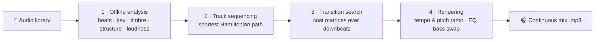
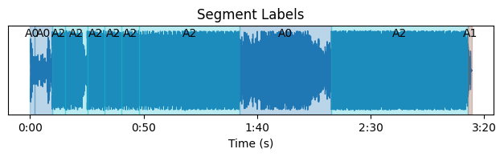
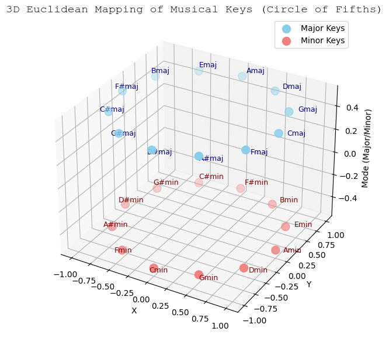
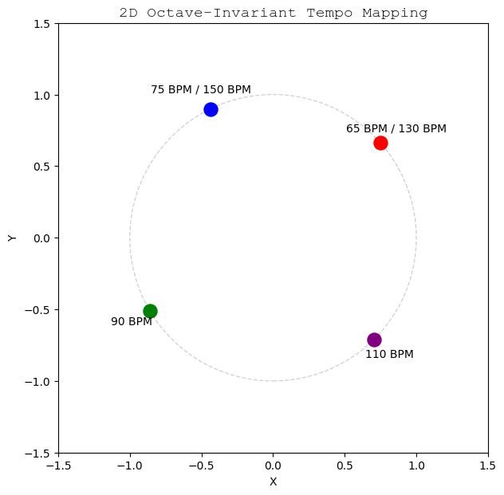
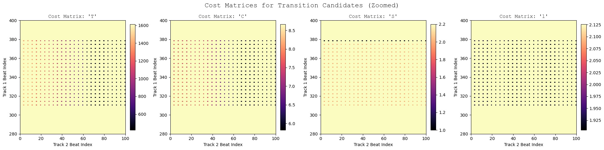
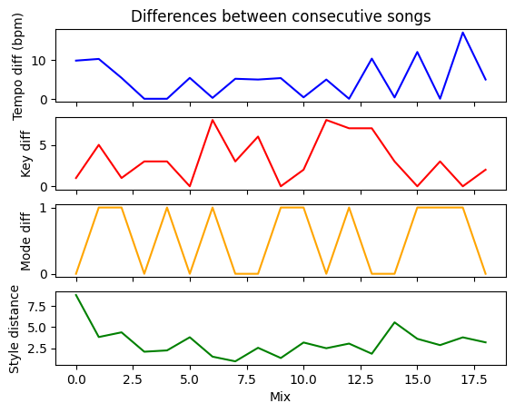
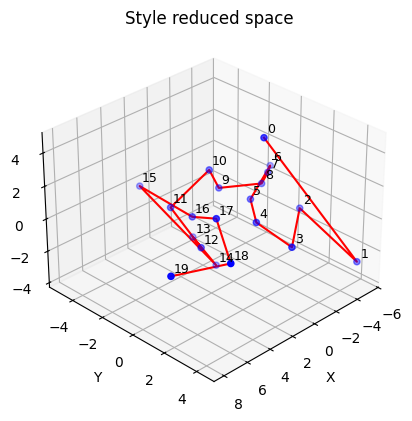
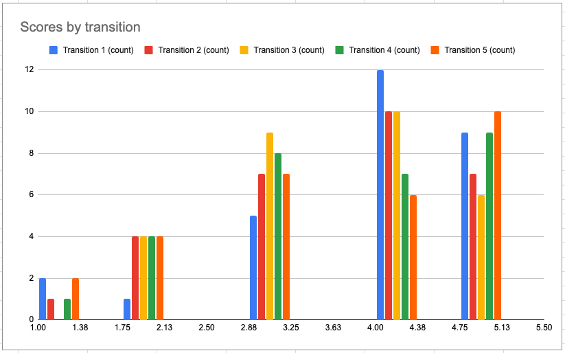

<div align="center">

# 🎧 Auto DJ Mixer

**Give it a folder of songs. It decides the order and mixes them into one continuous DJ set,
with beat-matched, key-aware transitions.**


</div>

---

## 🔊 Listen first

These transitions were generated end-to-end by the system. Nobody picked the songs, the order or the cut points.

<!--
  To make the video play inside the README, edit this file on github.com and drag
  assets/video/transition_demo_1.mp4 into the editor. GitHub replaces it with a
  user-attachments URL and renders an inline player.
-->

| Transition A | Transition B |
|---|---|
| [▶ transition_demo_1.mp4](assets/video/transition_demo_1.mp4) · [mp3](assets/audio/transition_demo_1.mp3) | [▶ transition_demo_2.mp4](assets/video/transition_demo_2.mp4) · [mp3](assets/audio/transition_demo_2.mp3) |

Each clip has three parts: 5 s of the outgoing track, the 32-beat transition the system built, and 10 s of the incoming track.

> **Listening test:** 29 people rated 5 generated transitions on a 1–5 scale. The average score was **3.7 / 5**, and every individual transition averaged between 3.6 and 3.8. The quality is consistent from transition to transition, so the result doesn't depend on one lucky mix.

---

## Why

Streaming platforms can now crossfade between songs, but the listener still has to decide the order. A bad order leads to jarring jumps in key, tempo or energy that no crossfade can hide. A human DJ handles both problems at once: they choose **what comes next** and **where and how to cut**. This project automates both decisions.

## How it works



### 1 · Offline analysis

Each track is analysed once and the result is cached, so building a new playlist later does not require reprocessing the audio.

| Feature | How it is computed | What it is used for |
|---|---|---|
| Beats & downbeats | **BeatNet** (offline mode, DBN inference) | Beat grid. Transitions are only allowed to start on a downbeat |
| Tempo | Median of inter-beat intervals with IQR outlier filtering and weighting | Sequencing, tempo ramp |
| Key & mode | CQT chroma correlated with Krumhansl–Schmuckler profiles | Harmonic mixing, pitch shift |
| Style vector (28-d) | Mean/std of 7-band **spectral contrast** and of its time derivative | Overall timbre and energy, used for sequencing |
| Timbre per beat | 13 **MFCCs**, beat-synchronous | Transition cost |
| Harmony per beat | 12-bin **chroma (CQT)**, beat-synchronous | Transition cost, crossfade type |
| Structure | Self-similarity matrix → checkerboard-kernel novelty → peak picking → agglomerative clustering | Structural cost |
| Loudness | A-weighted RMS, beat-synchronous | Transition cost |

Features computed per beat instead of per frame make the search much smaller, and they match how DJs think: you cut on the beat, never in the middle of one.

<p align="center">
  
</p>

### 2 · Track sequencing: the playlist as a graph problem

Every song is a node, and the edge weight between two songs is how different they are. The best playlist is the **shortest Hamiltonian path**: it visits every song exactly once with the smallest total distance.

Musical attributes are mapped into a Euclidean space so that geometric distance reflects how similar two songs sound:

- **Key → circle of fifths in 3D.** Related keys end up close together (C major sits next to G major), and major and minor keys are separated along the z-axis.
- **Tempo → an octave-invariant circle.** 65 BPM and 130 BPM land on the same point, since a DJ treats double and half time as compatible.
- **Style → standardised spectral-contrast vector.**

<p align="center">
  
  &nbsp;
  
</p>

Each block is standardised and multiplied by a user-chosen weight (by default style 0.5, key 0.3, tempo 0.2). The path is then found with the **HAM-2 greedy heuristic**, which repeatedly adds the closest unvisited song to whichever end of the path, head or tail, gives the smaller distance.

### 3 · Finding the best cut point

For every pair of consecutive songs:

1. **Candidate pruning.** Only downbeats in the last 25 % of the outgoing track and the first 20 % of the incoming track are considered.
2. **Cost matrices.** For every candidate pair *(i, j)*, the two 32-beat windows that would overlap are compared:
   - **T** (timbre): MFCC distance
   - **C** (harmony): chroma distance
   - **S** (structure): a penalty if the transition does not end on a section boundary
   - **L** (loudness): favours cutting while both tracks are in high-energy sections
3. The matrices are min-max normalised, combined with weights, and the **argmin** gives the transition start in each track.

<p align="center">
  
</p>

### 4 · Rendering the transition like a DJ would

- **Tempo ramp.** Inside the transition, beat *n* of *N* is time-stretched to a target duration
  `d_n = ((N−n)/N)·d_out + (n/N)·d_in`, so the tempo moves smoothly from one song's BPM to the other's and the beats stay aligned throughout ([before](assets/audio/sync_before.mp3) → [after](assets/audio/sync_after.mp3)).
- **Key glide.** The outgoing track is pitch-shifted gradually, beat by beat, towards the key of the incoming track, taking the smallest number of semitones.
- **Adaptive crossfade.** If the two windows are harmonically similar (chroma similarity > 0.8), the system uses a plain **harmonic blend**. Otherwise it uses a **3-stage EQ mix**: the incoming bass is held back, the two basses are swapped, and then the outgoing track is high-passed out. This keeps the low end from clashing ([blend](assets/audio/crossfade_harmonic_blend.mp3) vs [EQ](assets/audio/crossfade_eq_mix.mp3)).

---

## 🧪 Design decisions backed by experiments

**Which beat tracker?** The whole pipeline depends on accurate beats, so we benchmarked three trackers against ground-truth annotations (GTZAN *disco*, 100 tracks, F-measure, ±35 ms tolerance):

| Tracker | Mean F-measure | Time for 100 tracks |
|---|---|---|
| librosa | 0.70 | ~14 s |
| madmom | **0.95** | ~8 min |
| **BeatNet** ✅ | 0.83 | ~45 s |

madmom is the most accurate but about 10× slower. BeatNet sits in the useful middle: far more accurate than librosa and fast enough to analyse a whole library. The full study, including a second run on Harmonix Set EDM tracks, is in [`test/beat_tracking.ipynb`](test/beat_tracking.ipynb). On Harmonix Set all three trackers scored around 0.25, which points to an alignment problem between the re-downloaded audio and the annotations rather than to the trackers themselves.

## 📈 Results

The test set was 20 royalty-free house tracks. House has a steady 4/4 beat and long intros and outros, which makes it a good genre for testing transitions.

<p align="center">
  
  &nbsp;
  
</p>

- **Sequencing.** In the generated order, the tempo difference between consecutive songs stays small and the style distance stays flat across the whole set. In PCA space the path moves through one cluster of songs, makes a single jump, and then moves through the next cluster, which is what you would want from a set.
- **Transitions.** Rated **3.7 / 5** on average by 29 listeners, with a low spread between transitions.

<p align="center">
  
</p>

---

## 🚀 Quickstart

```bash
# Python 3.9 is required (BeatNet / madmom depend on an older numpy)
python -m venv .venv && source .venv/bin/activate   # Windows: .venv\Scripts\activate
pip install -r requirements.txt
# System tools: ffmpeg (pydub) and rubberband-cli (pyrubberband)
```

```python
from DJ_mixer import DJMixer

mixer = DJMixer({
    "track_sequencer":  {"sequencing_weights": {"style": 0.5, "key": 0.3, "tempo": 0.2}},
    "transition_maker": {"transition_length_beats": 32,          # 8 bars in 4/4
                         "cost_weights": {"T": 0.4, "C": 0.3, "S": 0.2, "L": 0.1}},
})

mixer.load_directory("my_music/")             # offline analysis (cache it with pickle)
mix = mixer.create_playlist(render=True)      # sequence + find transitions + render
mixer.store_audio(mix, "output/my_set.mp3")
```

Changing the weights changes the DJ's personality. Raise **key** and **tempo** for a smooth harmonic flow, or raise **style** to keep the energy and timbre consistent.

The step-by-step walkthrough with every plot and audio example is in [`report.ipynb`](report.ipynb).

## 📁 Project structure

```
├── DJ_mixer.py           # Orchestrator: library → playlist → rendered mix
├── feature_extractor.py  # TrackFeatures dataclass + offline analysis
├── feat_utils.py         # Tempo, key, segmentation, loudness helpers
├── track_sequencer.py    # Euclidean embeddings + HAM-2 shortest path
├── transition_maker.py   # Cost matrices, tempo/pitch ramp, EQ crossfades
├── report.ipynb          # Full technical report with figures and audio
├── test/beat_tracking.ipynb  # librosa vs madmom vs BeatNet benchmark
└── assets/               # Figures and audio demos for this README
```

## 🔭 Limitations & next steps

- **Genre.** Tested only on house music. For pop, vocals matter much more. A voice-activity cost (JaVAD) was implemented but had to be disabled because of a numpy version conflict with BeatNet.
- **Style embedding.** It is hand-crafted (spectral contrast). Learned audio embeddings would probably sequence better.
- **Sequencing.** It uses one global vector per song. Sequencing on how well the actual transition regions match would be more accurate.
- **Rendering.** It is rule-based. A small generative model trained only on transitions is an interesting direction.

## 📚 References

1. Vande Veire, L. & De Bie, T. (2018). *From raw audio to a seamless mix: creating an automated DJ system for Drum and Bass.* EURASIP Journal on Audio, Speech, and Music Processing. [link](https://asmp-eurasipjournals.springeropen.com/articles/10.1186/s13636-018-0134-8)
2. Bittner, R. et al. (2017). *Automatic Playlist Sequencing and Transitions.* ISMIR. [link](https://archives.ismir.net/ismir2017/paper/000086.pdf)

<sub>Test audio comes from the royalty-free catalogue of ProudMusicLibrary and is not redistributed in this repository.</sub>
